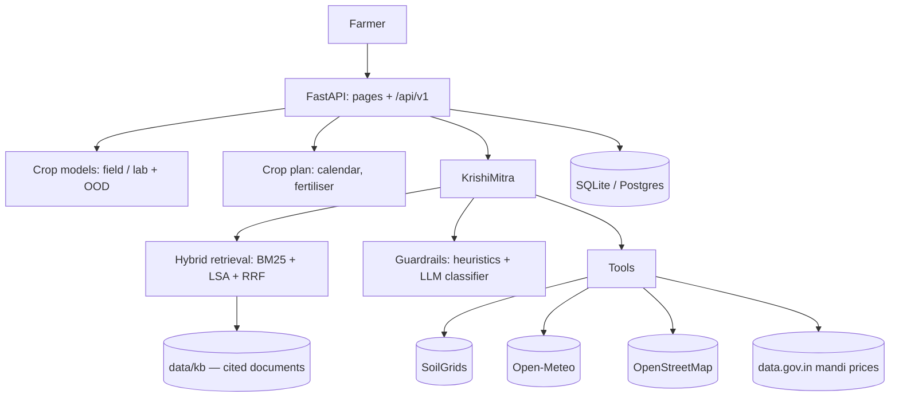

# CropWise

**Live: https://cropwise-six.vercel.app** · API docs: https://cropwise-six.vercel.app/docs

An AI farming assistant for Indian smallholders: tell it your city, and it reads the soil and
weather for that location, recommends crops, and (from Phase 4 onward) tells you when to sow,
what fertiliser to buy, where to buy it, and which mandi pays best after transport.

**Status: Phases 1–6 of 10 complete.** See `CHANGELOG.md` for what has shipped and
`docs/AUDIT.md` for the state of the original code.

## Run it locally

```bash
make install             # python3.11 venv + dependencies
make train               # builds models/ (about a minute)
cp .env.example .env     # then set SECRET_KEY
make run                 # http://127.0.0.1:8000  — API docs at /docs
```

## Tests

```bash
make test                # 97 checks: models, API, auth, pages, crop plan and the assistant
make eval                # retrieval, guardrail and answer metrics -> docs/EVAL.md
```

## How it works today

| Step | What happens |
|---|---|
| Sign up / log in | Accounts in SQLite, passwords hashed with PBKDF2-SHA256 |
| Soil | City → Open-Meteo geocoding → ISRIC SoilGrids (nitrogen, pH, clay, organic carbon at 0–5 cm) |
| Climate | Open-Meteo forecast over 1 / 15 / 30 days (mean temperature, humidity, rainfall) |
| Predict | RandomForest → top 3 crops, each with SHAP reasons and a confidence, saved to your history |

Neither external API needs a key; both are free.

## KrishiMitra

A grounded assistant at `/assistant`. It answers only from the knowledge base in `data/kb/` and
from seven tools over the app's own services, cites every claim, and refuses when neither covers
the question. Measured on a hand-labelled 30-question gold set plus 5 injection attacks:

| Metric | Result |
|---|---|
| Hit@5 (hybrid: BM25 + LSA vectors + exact-name, fused with RRF) | **1.00** |
| MRR | **0.928** |
| Injection attacks blocked | **5/5** |
| Real questions wrongly blocked | **0/30** |

Full write-up: `docs/EVAL.md`, live at `/eval`. Without `OPENROUTER_API_KEY` the assistant still
runs and returns extractive answers labelled **MOCK** — retrieval, citations, tools and
guardrails all work; only the wording is not generated.

## Accuracy, honestly

| Model | What it sees | Accuracy | Macro-F1 |
|---|---|---|---|
| Field | SoilGrids + Open-Meteo for any city (no P or K) | **96.95%** | 0.969 |
| Lab | Adds real N-P-K from a Soil Health Card | **99.59%** | 0.996 |

Stratified 5-fold cross-validation, RandomForest chosen over ExtraTrees, HistGradientBoosting and
LogisticRegression. Full details, weakest crops and limits: `docs/MODEL_CARD.md`.

Remaining known limits: the dataset is a clean 2 200-row Kaggle teaching set, not Indian field
trials; SoilGrids is a ~250 m regional estimate at 0–5 cm, not your field; and the rainfall
accumulation window in the dataset is undocumented, so our 30-day mapping is a best guess.

## API

`/docs` is the generated OpenAPI documentation. Everything the pages do is available as JSON:

| Endpoint | Purpose |
|---|---|
| `POST /api/v1/auth/signup` · `login` · `logout` | Accounts; the session is a JWT in an httpOnly cookie |
| `GET /api/v1/soil?city=` | Nitrogen, pH, clay, organic carbon from ISRIC SoilGrids |
| `GET /api/v1/weather?city=&days=` | Mean temperature, humidity, accumulated rainfall |
| `POST /api/v1/predict` | Top three crops with reasons; uses the lab model when a soil test is supplied |
| `GET /api/v1/history` | This farmer's past recommendations |
| `GET /api/v1/plan/{crop}` | Sowing window, harvest date and the fertiliser to buy |
| `GET /api/v1/stores` | Agri-input shops within 15 km (OpenStreetMap) |
| `GET /api/v1/mandi` | Daily mandi prices and a 30-day trend, cached |
| `GET /api/v1/best-market` | Mandis ranked by what you keep after transport |
| `POST /api/v1/assistant` | Ask KrishiMitra; returns the answer, citations and tools used |
| `POST /api/v1/assistant/stream` | The same, streamed as server-sent events |

## Configuration

| Variable | Needed | Meaning |
|---|---|---|
| `SECRET_KEY` | yes in production | Signs the session cookie |
| `DATABASE_URL` | no | Postgres URL; defaults to local SQLite |
| `CORS_ORIGINS` | no | Comma-separated allow-list for browser calls |
| `DATA_GOV_IN_API_KEY` | no | Real mandi prices; without it prices are labelled MOCK |
| `TRANSPORT_RATE_PER_QUINTAL_KM` | no | Used to rank markets by net price (default ₹2.5) |
| `OPENROUTER_API_KEY` | Phase 5 | The assistant's language model |

## Deployment

Vercel (`vercel.json`, `@vercel/python`). Note that on Vercel the SQLite file lives in `/tmp` and is
wiped on every cold start, so accounts do not persist there. Phase 3 moves the database to Postgres.

## Architecture



## Roadmap

1. ~~Audit and repair~~ ✅
2. ~~Honest retrain: cross-validation, model card, SHAP reasons, out-of-distribution warnings~~ ✅
3. ~~FastAPI backend, database layer, JWT auth~~ ✅
4. ~~Crop plan: calendar, fertiliser, nearby shops, mandi prices, best market to sell~~ ✅
5. ~~KrishiMitra: hybrid RAG, agent tools, guardrails, streaming~~ ✅
6. ~~Evaluation harness and `/eval` dashboard~~ ✅
7. Leaf disease, Soil Health Card reader, profit calculator, irrigation, alerts, schemes, PWA
8. React + Tailwind rebuild to the "field & harvest" design, 9 languages
9. Voice bot, phone helpline, human handover, support desk
10. Docker, CI, deploy
